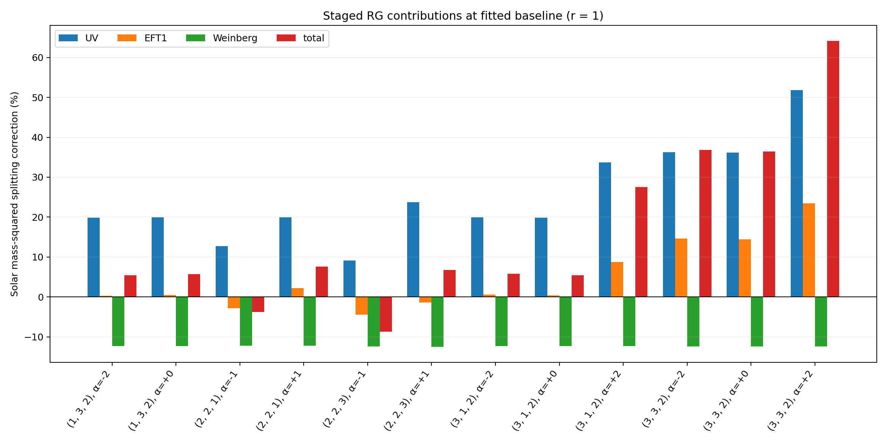
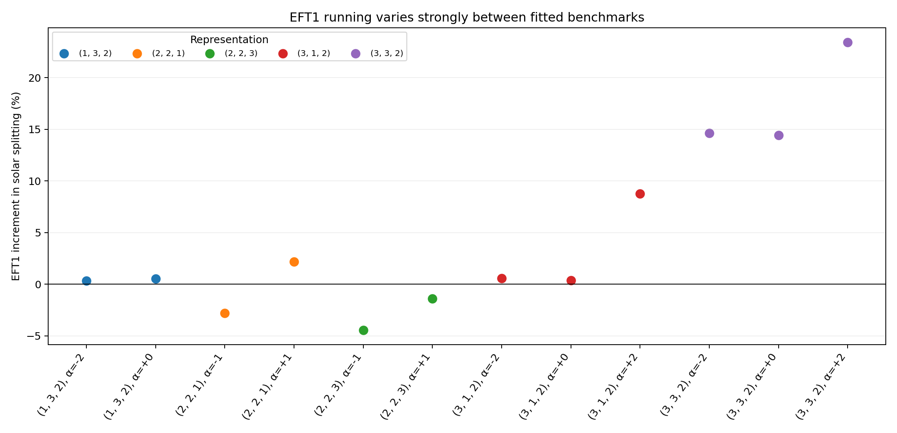
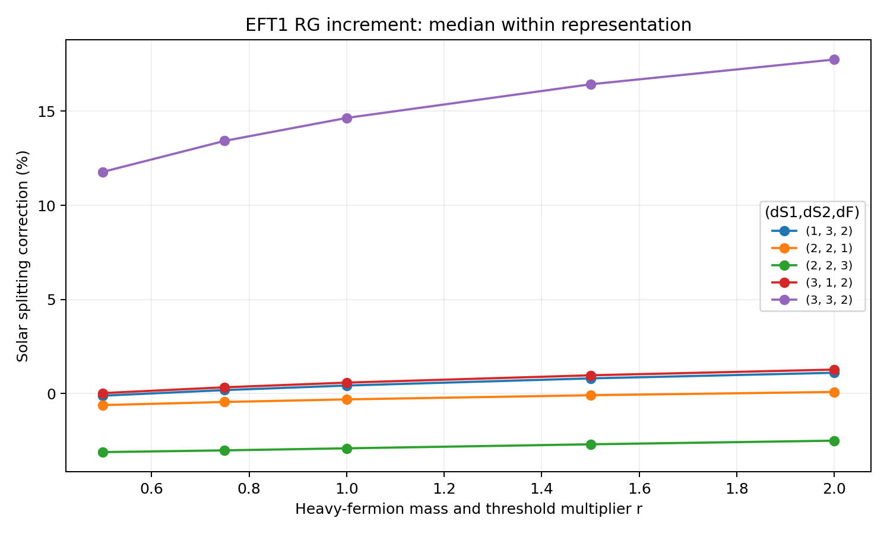

# Numerical results: T3 neutrino-mass running (draft)

**Status:** draft based on completed exploratory scans, scenario `smallY_smallL`, 15 October 2026. Numerical values are drawn from the local staged-scan `scan.csv`, representation-summary CSV and recorded findings; no additional integrations were performed for this draft. References and cross-references to a final thesis chapter remain to be inserted.

## Benchmark selection and numerical procedure

We consider fitted benchmarks of five T3 electroweak representation classes, indexed by $(d_{S1},d_{S2},d_F)$ and hypercharge parameter $\alpha$. Sixteen benchmark models were fitted, of which twelve have compatible stored numerical artifacts for the staged-running calculation. Four cases, $(1,3,2)$ with $\alpha=-4$, $(2,2,1)$ and $(2,2,3)$ with $\alpha=-3$, and $(3,3,2)$ with $\alpha=-4$, were omitted because the corresponding matching/RGE artifacts were unavailable; this is a coverage limitation, not a demonstrated physical exclusion.

The implemented fermion-first effective-field-theory trajectory follows

$$
\mu_{\rm UV}>\mu_F>\mu_S>\mu_{\rm low},
$$

with UV running above the heavy-fermion threshold, scalar-only EFT running between the fermion and scalar thresholds, and Standard Model plus Weinberg-operator running below the scalar threshold. Existing matching prescriptions are retained at both thresholds. The fitted scenario uses $\mu_F=10^5\,\mathrm{GeV}$ and $\mu_S=10^3\,\mathrm{GeV}$ at the baseline.

For a fixed benchmark we calculate four cumulative cases: `000` (no UV, intermediate, or Weinberg evolution), `100` (UV evolution only), `110` (UV and intermediate evolution), and `111` (all three stages). The conditional incremental change of an observable $O$ between adjacent cases is

$$
\delta_O(A\to B)=100\left(\frac{O_B}{O_A}-1\right)\%.
$$

These changes form an **order-dependent numerical ablation**: switching off UV or intermediate evolution freezes the state across that interval while retaining the threshold projection and matched Wilson-coefficient evaluation. For the final stage, the Weinberg coefficient is held fixed in the reference but the same fully evolved low-energy charged-lepton basis is used for the observable extraction. Consequently, the decomposition does not uniquely allocate scheme-independent loop effects among the three regions.

## Staged running at the fitted point

All sixty attempted calculations (twelve models at each of five mass factors) succeeded; the twelve $r=1$ full-running predictions reproduce the fitted baseline with maximum reported $\chi^2=0.003701$. At $r=1$, median incremental changes in the solar mass-squared splitting are $+19.951\%$ for UV running, $+0.549\%$ for intermediate running and $-12.336\%$ for final Weinberg evolution. The median full-versus-frozen correction is $+6.268\%$. The analogous atmospheric values are $+19.892\%$, $+0.549\%$, $-12.336\%$, and $+6.079\%$.

The three median increments must **not** be added to obtain the median total. For each *individual model*, multiplicative corrections satisfy

$$
\frac{O_{111}}{O_{000}}=
\frac{O_{100}}{O_{000}}
\frac{O_{110}}{O_{100}}
\frac{O_{111}}{O_{110}}.
$$

The positive UV and negative final-stage changes typically oppose one another, reducing the net modification compared with either contribution alone (Figure 1). The intermediate-stage correction has a smaller across-model median but a considerably larger spread: at $r=1$ its solar increment ranges from $-4.438\%$ to $+23.420\%$ (Figure 2).

*Figure 1. Incremental UV, intermediate-EFT and Weinberg corrections, and overall correction, to $\Delta m_{21}^2$ at the fitted baseline, shown model by model. Percentages have distinct reference predictions for each stage.*

*Figure 2. Variation of the intermediate-EFT increment in the solar splitting across the twelve available fitted benchmarks.*

## Representation comparison

The representation-class medians for the solar mass-squared difference are:

| Representation | Fitted models | UV | EFT1 | Weinberg | Total |
|---|---:|---:|---:|---:|---:|
| (1, 3, 2) | 2 | +19.91% | +0.42% | -12.34% | +5.56% |
| (2, 2, 1) | 2 | +16.33% | -0.31% | -12.21% | +1.89% |
| (2, 2, 3) | 2 | +16.43% | -2.91% | -12.46% | -0.95% |
| (3, 1, 2) | 3 | +19.96% | +0.58% | -12.33% | +5.77% |
| (3, 3, 2) | 3 | +36.22% | +14.64% | -12.40% | +36.79% |

The $(3,3,2)$ class stands out in this benchmark collection, with median UV and intermediate-EFT increments of $+36.22\%$ and $+14.64\%$, respectively, and a median overall correction of $+36.79\%$. By comparison, the $(2,2,3)$ class has a median intermediate increment of $-2.91\%$. The individual extremes include $(2,2,3),\alpha=-1$ at $-4.438\%$ and $(3,3,2),\alpha=+2$ at $+23.420\%$.

Because each model was fitted separately, these contrasts jointly reflect gauge representation, hypercharge and fitted couplings. The dataset does **not** identify a representation-only causal effect. Class medians are descriptive and are based on only two or three available models each.

## Dependence on the fermion threshold

We varied both the physical fermion mass matrix and the fermion matching scale according to $M_F\mapsto rM_F$ and $\mu_F\mapsto r\mu_F$, with $r=0.5,0.75,1,1.5,2$. The scalar threshold and other fitted UV parameters were retained. This is a physical-mass/threshold sensitivity test, **not** a pure variation of an arbitrary renormalisation scale. Only $r=1$ was fitted to the oscillation target.

The median solar UV contribution decreases from $+23.568\%$ at $r=0.5$ to $+16.678\%$ at $r=2$, whereas the intermediate contribution changes from approximately $-0.004\%$ to $+1.240\%$. The final Weinberg contribution is nearly constant, from $-12.350\%$ to $-12.322\%$, consistent with the final running interval being unchanged. The overall median correction changes from $+9.092\%$ to $+3.760\%$ across the same range.

*Figure 3. Intermediate-EFT correction to the solar splitting versus fermion-to-scalar threshold ratio, summarised by representation class. Class differences also include differences among fitted inputs.*

## Oscillation-angle response and physical interpretation

Changes to the fitted mixing angles are generally much smaller than changes to the mass-squared differences. At $r=1$, the median UV correction to $\sin^2\theta_{13}$ is approximately $+0.1974\%$, the intermediate correction is numerically indistinguishable from zero in the saved dataset, and the Weinberg correction is approximately $+0.000214\%$. The corresponding Weinberg corrections to the two mass-squared differences are both approximately $-12.34\%$. A nearly common rescaling of the neutrino mass matrix provides a useful interpretation: a $-12.34\%$ mass-squared change would correspond to a neutrino-mass factor of about $\sqrt{0.8766}\simeq 0.936$ if all masses rescaled uniformly. This is an empirical interpretation, not proof of exact flavour-universal running.

The coupling-rescaling study further probes UV-parameter sensitivity with the *full* RG calculation retained. In the three T1/T2/T3 deformations the nominal product $\lambda_{T3}(y_1y_2+y_2y_1)$ is preserved at the UV input, while individual factors vary. The resulting observable motion cannot be interpreted as a stand-alone RGE correction; non-baseline numerical failures in the broad T1/T2 scans must not be bridged when plotting.

## Conclusions and limitations

The numerical study establishes, for the fitted and artifact-supported T3 benchmarks, that (i) running above the fermion threshold and below the scalar threshold produces substantial and often opposing corrections to the neutrino mass-squared splittings; (ii) the intermediate scalar EFT can be numerically important for specific fitted models despite its small median correction; and (iii) the mixing angles are relatively stable in comparison with the absolute neutrino-mass scale. The staged decomposition is conditional on the chosen frozen-state and charged-lepton-basis convention; it is not a unique diagrammatic attribution. Four fitted models remain unstudied in the staged analysis owing to missing generated numerical artifacts. These results are exploratory and should not be read as a global parameter-space exclusion or a controlled isolated test of representation alone.

## Data provenance

- Source staged scan: `Reports/output/full/staged_rg_comparison/smallY_smallL/scan.csv` and `scan.json` (previously uploaded archive).
- Derived representation data: `Reports/output/full/representation_comparison/smallY_smallL/representation_summary.csv` and `baseline_stage_contributions.csv` (inspected directly for this draft).
- Consolidated results log: `Reports/notes/T3_Numerical_Findings.md`.
- The three figures in this folder were copied directly from the generated representation-comparison archive; they were not redrawn.
